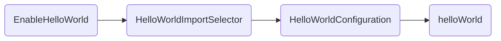

{
  "title": "SpringBoot源码分析2——走向自动装配",
  "date": "2020-12-10T17:28:00+08:00",
  "lastmod": "2023-09-07T15:06:38+08:00",
  "typecho_cid": 249,
  "url": "/archives/249/",
  "comments": false,
  "draft": false,
  "slug": "249",
  "categories": [
    "学习"
  ],
  "tags": [
    "Java",
    "SpringBoot",
    "源码学习"
  ],
  "math": true
}

## Spring Framework 手动装配


### Spring模式注解装配
- 定义:一种用于声明在应用中扮演“组件”角色的注解
- 举例:`@Component`、`@Service`、`@Configuration`等
- 装配:`< context: component-scan>`或`@Componentscan`


[官方仓库](https://github.com/spring-projects/spring-framework/wiki/Spring-Annotation-Programming-Model#stereotype-annotations)说明

> ## Stereotype Annotations
>
> A **\*stereotype annotation*** is an annotation that is used to declare the role that a component plays within the application. For example, the `@Repository` annotation in the Spring Framework is a marker for any class that fulfills the role or *stereotype* of a repository (also known as Data Access Object or DAO).
>
> `@Component` is a generic stereotype for any Spring-managed component. Any component annotated with `@Component` is a candidate for component scanning. Similarly, any component annotated with an annotation that is itself meta-annotated with `@Component` is also a candidate for component scanning. For example, `@Service` is meta-annotated with `@Component`.
>
> Core Spring provides several stereotype annotations out of the box, including but not limited to: `@Component`, `@Service`, `@Repository`, `@Controller`, `@RestController`, and `@Configuration`. `@Repository`, `@Service`, etc. are specializations of `@Component`.


模式注解是一种用于声明在应用中扮演“组件”角色的注解。如 Spring Framework 中的 `@Repository` 标注在任何类上 ，用于扮演仓储角色的模式注解。

`@Component `作为一种由 Spring 容器托管的通用模式组件，任何被` @Component` 标准的组件均为组件扫描的候选对象。类似地，凡是被 `@Component `元标注（**meta-annotated**）的注解，如` @Service` ，当任何组件标注它时，也被视作组件扫描的候选对象（派生性）


#### 模式注解举例 

| Spring Framework 注解 | 场景说明 | 起始版本 |
| --------------------- | -------- | -------- |
| `@Repository` | 数据仓储模式注解 | 2.0 |
| `@Component` | 通用组件模式注解 | 2.5 |
| `@Service` | 服务模式注解 | 2.5 |
| `@Controller` | Web控制器模式注解 | 2.5 |
| `@Configuration` | 配置类模式注解 | 3.0 |


### 装配方式 


`<context:component-scan> `方式 

```xml
<?xml version="1.0" encoding="UTF-8"?>
<beans xmlns="http://www.springframework.org/schema/beans"
       xmlns:xsi="http://www.w3.org/2001/XMLSchema-instance"
       xmlns:context="http://www.springframework.org/schema/context"
       xsi:schemaLocation="http://www.springframework.org/schema/beans 
http://www.springframework.org/schema/beans/spring-beans.xsd
    http://www.springframework.org/schema/context http://www.springframework.org/schema/context/spring-
context.xsd">
 
    <!-- 激活注解驱动特性 -->
    <context:annotation-config />
 
    <!-- 找寻被 @Component 或者其派生 Annotation 标记的类（Class），将它们注册为 Spring Bean -->
    <context:component-scan base-package="top.fjy8018.spring.boot" />
 
</beans>
```


`@ComponentScan `方式 

```java
@ComponentScan(basePackages = "top.fjy8018.spring.boot")
public class SpringConfiguration {
    ...
}
```


## Spring Framework手动装配


### 自定义模式注解 

 

#### `@Component `“派生性” 

```java
package top.fjy8018.springboot.annotation;

import org.springframework.stereotype.Component;
import org.springframework.stereotype.Repository;

import java.lang.annotation.*;

/**
 * @author F嘉阳
 * @date 2018-09-09 10:36
 */
@Target({ElementType.TYPE})
@Retention(RetentionPolicy.RUNTIME)
@Documented
@Repository
public @interface FirstLevelRepository {

    /**
     * 保证签名一致性
     */
    String value() default "";
}

```

三个级别并无明显区别，体现注解派生性，即使用`@FirstLevelRepository`和使用`@Component`效果一致

派生关系

- `@Component`
  - `@Repository`
    - `@FirstLevelRepository`


```java
package org.springframework.stereotype;

/**
 * @since 2.5
 */
@Target(ElementType.TYPE)
@Retention(RetentionPolicy.RUNTIME)
@Documented
@Indexed
public @interface Component {

  /**
   * Component的签名
   */
  String value() default "";

}
```


`Repository`中元标注了`@Component`

```java
package org.springframework.stereotype;

/**
 * @since 2.0
 * @see Component
 */
@Target({ElementType.TYPE})
@Retention(RetentionPolicy.RUNTIME)
@Documented
@Component
public @interface Repository {

  /**
   * 签名与Component一致
   */
  @AliasFor(annotation = Component.class)
  String value() default "";
}
```


#### `@Component` “层次性” 

```java
package top.fjy8018.springboot.annotation;

import org.springframework.stereotype.Component;
import org.springframework.stereotype.Repository;

import java.lang.annotation.*;

/**
 * Component层次性
 * 顶级 {@link Component}
 * 一级 {@link Repository @Repository}
 * 二级 {@link FirstLevelRepository}
 * 三级 {@link SecondLevelRepository}
 *
 * @author F嘉阳
 * @date 2018-09-09 10:54
 */
@Target({ElementType.TYPE})
@Retention(RetentionPolicy.RUNTIME)
@Documented
@FirstLevelRepository
public @interface SecondLevelRepository {

    /**
     * 层次性、派生性都必须保证签名一致
     */
    String value() default "";
}

```


- @Component
  - @Repository
    - FirstLevelRepository
      - SecondLevelRepository

 

注解目标类，`value` 为bean的名称，此处不管用`@FirstLevelRepository`还是用`SecondLevelRepository`，效果都和使用`@Component`一致

```java
package top.fjy8018.springboot.repository;

import top.fjy8018.springboot.annotation.FirstLevelRepository;

/**
 * @author F嘉阳
 * @date 2018-09-09 10:40
 */
//@Component("myRepository")
@FirstLevelRepository(value = "myRepository")
//@SecondLevelRepository(value = "myRepository")
public class RepositoryDemo {
}

```


仓储引导类，使用`@ComponentScan`指定扫描Bean路径

```java
package top.fjy8018.springboot.bootstrap;

import org.springframework.boot.WebApplicationType;
import org.springframework.boot.builder.SpringApplicationBuilder;
import org.springframework.context.ConfigurableApplicationContext;
import org.springframework.context.annotation.ComponentScan;
import top.fjy8018.springboot.repository.RepositoryDemo;

/**
 * @author F嘉阳
 * @date 2018-09-09 10:43
 */
@ComponentScan(basePackages = "top.fjy8018.springboot.repository")
public class RepositoryBootstrapDemo {

    public static void main(String[] args) {
        ConfigurableApplicationContext applicationContext = new SpringApplicationBuilder(RepositoryBootstrapDemo.class)
                .web(WebApplicationType.NONE)
                .run(args);

        // 通过bean名称获取bean
        RepositoryDemo myRepository = applicationContext.getBean("myRepository", RepositoryDemo.class);

        // myRepository是否存在，若不存在则报错
        System.out.println("myRepository是否存在：" + myRepository);

        // 关闭上下文
        applicationContext.close();
    }
}
```


执行结果


SpringBoot源码中也有体现该层次关系

- `@SpringBootApplication`
  - `@SpringBootConfiguration`
    - `@Configuration`
      - `@Component`
  - `@EnableAutoConfiguration`
    - `@AutoConfigurationPackage`


 

### Spring @Enable 模块装配 


Spring Framework 3.1 开始支持“@Enable 模块驱动”。所谓“模块”是指具备相同领域的功能组件集合， 组合所形成一个独立的单元。比如 Web MVC 模块、AspectJ代理模块、Caching（缓存）模块、JMX（Java 管理扩展）模块、Async（异步处理）模块等。


- 举例:`@EnableWebmvc`、`@EnableAutoConfiguration`等
- 实现:注解方式、编程方式

 

`@Enable` 注解模块举例 

| 框架实现 | `@Enable` 注解模块 | 激活模块 |
| -------- | ---------------- | -------- |
| Spring Framework | `@EnableWebMvc` | Web |
| | `@EnableTransactionManagement` | 事务管理模块 |
| | `@EnableCaching` | Caching 模块 |
| | `@EnableMBeanExport` | JMX 模块 |
| | `@EnableAsync` | 异步处理模块 |
| | `EnableWebFlux` | Web Flux 模块 |
| | `@EnableAspectJAutoProxy` | AspectJ 代理模块 |
|  |  | |
| Spring Boot | `@EnableAutoConfiguration` | 自动装配模块 |
| | `@EnableManagementContext` | Actuator 管理模块 |
| | `@EnableConfigurationProperties` | 配置属性绑定模块 |
| | `@EnableOAuth2Sso` | OAuth2 单点登录模块 |
|  |  | |
| Spring Cloud | `@EnableEurekaServer` | Eureka服务器模块 |
| | `@EnableConfigServer` | 配置服务器模块 |
| | `@EnableFeignClients` | Feign客户端模块 |
| | `@EnableZuulProxy` | 服务网关 |
| | `@EnableCircuitBreaker` | 服务熔断模块 |


 

#### 实现方式 

 

##### 注解驱动方式 

Spring源码，使用`@Import`注入配置Bean

```java
package org.springframework.web.servlet.config.annotation;

@Retention(RetentionPolicy.RUNTIME)
@Target(ElementType.TYPE)
@Documented
@Import(DelegatingWebMvcConfiguration.class)
public @interface EnableWebMvc {}
```


##### 接口编程方式 

Spring源码——激活缓存注解

```java
package org.springframework.cache.annotation;

@Target(ElementType.TYPE)
@Retention(RetentionPolicy.RUNTIME)
@Documented
@Import(CachingConfigurationSelector.class)
public @interface EnableCaching {...}
```


`CachingConfigurationSelector`类图


`ImportSelector`接口源码，该接口在3.1引入，目的在于增加灵活度

`selectImports`方法返回数组，即可以死是多个配置Bean

```java
package org.springframework.context.annotation;

/**
 * @since 3.1
 */
public interface ImportSelector {
  
    String[] selectImports(AnnotationMetadata importingClassMetadata);
}

```


#### @Enable注解方式自定义实现

激活HelloWorld模块，使用`@Import(HelloWorldConfiguration.class)`直接注入`HelloWorldConfiguration`模块


```java
package top.fjy8018.springboot.annotation;

import org.springframework.context.annotation.Import;
import top.fjy8018.springboot.configuration.HelloWorldConfiguration;

import java.lang.annotation.*;

/**
 * @author F嘉阳
 * @date 2018-09-09 11:35
 */
@Retention(RetentionPolicy.RUNTIME)
@Target(ElementType.TYPE)
@Documented
@Import(HelloWorldConfiguration.class)
public @interface EnableHelloWorld {}
```


目标类，其注解`@Configuration`在Spring3.0时引入

```java
package top.fjy8018.springboot.configuration;

import org.springframework.context.annotation.Bean;
import org.springframework.context.annotation.Configuration;

/**
 * @author F嘉阳
 * @date 2018-09-09 11:31
 */
@Configuration
public class HelloWorldConfiguration {

    /**
     * 方法名称即Bean名称
     * @return Hello World!
     */
    @Bean
    public String helloWorld() {
        return "Hello world!";
    }
}
```


```java
package org.springframework.context.annotation;

/**
 * @since 3.0
 */
@Target(ElementType.TYPE)
@Retention(RetentionPolicy.RUNTIME)
@Documented
@Component
public @interface Configuration {
  @AliasFor(annotation = Component.class)
  String value() default "";
}
```


#### @Enable接口编程方式自定义实现

参考Spring包名路径创建自定义Selector，通过`HelloWorldImportSelector`实现`HelloWorldConfiguration`的配置Bean导入

```java
package top.fjy8018.springboot.annotation;

import org.springframework.context.annotation.ImportSelector;
import org.springframework.core.type.AnnotationMetadata;
import top.fjy8018.springboot.configuration.HelloWorldConfiguration;

/**
 * @author F嘉阳
 * @date 2018-09-09 11:28
 */
public class HelloWorldImportSelector implements ImportSelector {

    /**
     * @param importingClassMetadata 元数据信息
     * @return 一个或多个配置Bean
     */
    @Override
    public String[] selectImports(AnnotationMetadata importingClassMetadata) {
        return new String[]{HelloWorldConfiguration.class.getName()};
    }
}
```


激活模块方式变化，使用`@Import(HelloWorldImportSelector.class)`注入`HelloWorldImportSelector`模块，在Selector里加载并返回 `HelloWorldConfiguration` 模块

```java
package top.fjy8018.springboot.annotation;

import org.springframework.context.annotation.Import;
import top.fjy8018.springboot.configuration.HelloWorldConfiguration;

import java.lang.annotation.*;

/**
 * @author F嘉阳
 * @date 2018-09-09 11:35
 */
@Retention(RetentionPolicy.RUNTIME)
@Target(ElementType.TYPE)
@Documented
//@Import(HelloWorldConfiguration.class)
@Import(HelloWorldImportSelector.class)
public @interface EnableHelloWorld {
}

```


##### 实现逻辑




此方法比直接注解驱动更有弹性，可增加switch条件返回不同的模块，源码样例`CachingConfigurationSelector`

```java
package org.springframework.cache.annotation;
public class CachingConfigurationSelector extends AdviceModeImportSelector<EnableCaching> {
  
    @Override
  public String[] selectImports(AdviceMode adviceMode) {
    switch (adviceMode) {
      case PROXY:
        return getProxyImports();
      case ASPECTJ:
        return getAspectJImports();
      default:
        return null;
    }
  }
    ...
}
```


## Spring条件装配

从 Spring Framework 3.1 开始，允许在 Bean 装配时增加前置条件判断

| Spring 注解    | 场景说明       | 起始版本 |
| -------------- | -------------- | -------- |
| `@Profile`     | 配置化条件装配 | 3.1      |
| `@Conditional` | 编程条件装配   | 4.0      |


### 条件注解实现方式 

 

 

#### 配置方式 - `@Profile`


在spring4后实现方式发生变化，依赖`@Conditional`和`ProfileCondition`实现

 ```java
package org.springframework.context.annotation;

/**
 * @since 3.1
 */
@Target({ElementType.TYPE, ElementType.METHOD})
@Retention(RetentionPolicy.RUNTIME)
@Documented
@Conditional(ProfileCondition.class)
public @interface Profile {...}
 ```


```java
package org.springframework.context.annotation;

/**
 * @since 4.0
 */
class ProfileCondition implements Condition {...}
```


通过上下文对象和注解元信息判断

```java
package org.springframework.context.annotation;

/**
 * @since 4.0
 */
@FunctionalInterface
public interface Condition {
  boolean matches(ConditionContext context, AnnotatedTypeMetadata metadata);
}
```


 

#### 编程方式 - `@Conditional `


`ConditionalOnClass`用于判断标识类在当前classpath下是否存在，该注解使用`@Conditional`搭配`OnClassCondition`实现

```java
package org.springframework.boot.autoconfigure.condition;

/**
 * {@link Conditional} that only matches when the specified classes are on the classpath.
 */
@Target({ ElementType.TYPE, ElementType.METHOD })
@Retention(RetentionPolicy.RUNTIME)
@Documented
@Conditional(OnClassCondition.class)
public @interface ConditionalOnClass {...}
```


```java
package org.springframework.boot.autoconfigure.condition;

/**
 * {@link Condition} that checks if properties are defined in environment.
 * @since 1.1.0
 * @see ConditionalOnProperty
 */
@Order(Ordered.HIGHEST_PRECEDENCE + 40)
class OnPropertyCondition extends SpringBootCondition {
    @Override
  public ConditionOutcome getMatchOutcome(ConditionContext context,
      AnnotatedTypeMetadata metadata) {
        // 获取元信息
    List<AnnotationAttributes> allAnnotationAttributes = annotationAttributesFromMultiValueMap(
        metadata.getAllAnnotationAttributes(
            ConditionalOnProperty.class.getName()));
    List<ConditionMessage> noMatch = new ArrayList<>();
    List<ConditionMessage> match = new ArrayList<>();
    for (AnnotationAttributes annotationAttributes : allAnnotationAttributes) {
      ConditionOutcome outcome = determineOutcome(annotationAttributes,
          context.getEnvironment());
      (outcome.isMatch() ? match : noMatch).add(outcome.getConditionMessage());
    }
    if (!noMatch.isEmpty()) {
      return ConditionOutcome.noMatch(ConditionMessage.of(noMatch));
    }
    return ConditionOutcome.match(ConditionMessage.of(match));
  }
    ...
}
```


`OnPropertyCondition`为抽象类，实际仍然是`Condition`接口的实现

```java
package org.springframework.boot.autoconfigure.condition;

public abstract class SpringBootCondition implements Condition {...}
```


`ConditionalOnProperty`用于判断配置在上下文中是否存在

```java
package org.springframework.boot.autoconfigure.condition;

/**
 * @since 1.1.0
 */
@Retention(RetentionPolicy.RUNTIME)
@Target({ ElementType.TYPE, ElementType.METHOD })
@Documented
@Conditional(OnPropertyCondition.class)
public @interface ConditionalOnProperty {...}
```


### 自定义条件装配

目标服务

```java
package top.fjy8018.springboot.service;

/**
 * 计算模块
 * @author F嘉阳
 * @date 2018-09-09 11:56
 */
public interface CalculateService {

    /**
     * 多整数求和
     * @param values 多个整数
     * @return 累加值
     */
    Integer sum(Integer... values);
}
```


#### 基于配置方式

服务实现类，分别使用 for循环实现和Lambda实现，均标注`@Service`作为Bean自动注入

指定`@Profile("Java7")`，当条件为Java7时才装配

```java
package top.fjy8018.springboot.service.impl;

import org.springframework.context.annotation.Profile;
import org.springframework.stereotype.Service;
import top.fjy8018.springboot.service.CalculateService;

/**
 * @author F嘉阳
 * @date 2018-09-09 11:57
 */
@Profile("Java7")
@Service
public class Java7CalculateServiceImpl implements CalculateService {

    /**
     * 多整数求和
     *
     * @param values 多个整数
     * @return 累加值
     */
    @Override
    public Integer sum(Integer... values) {
        System.out.println("计算模块java7 for循环实现");
        int sum = 0;
        for (int i = 0; i < values.length; i++) {
            sum += values[i];
        }
        return sum;
    }
}
```


指定`@Profile("Java8")`，当条件为Java7时才装配

```java
package top.fjy8018.springboot.service.impl;

import org.springframework.context.annotation.Profile;
import org.springframework.stereotype.Service;
import top.fjy8018.springboot.service.CalculateService;

import java.util.stream.Stream;

/**
 * @author F嘉阳
 * @date 2018-09-09 11:57
 */
@Profile("Java8")
@Service
public class Java8CalculateServiceImpl implements CalculateService {

    /**
     * 多整数求和
     * @param values 多个整数
     * @return 累加值
     */
    @Override
    public Integer sum(Integer... values) {
        System.out.println("计算模块java8 Lambda实现");
        return Stream.of(values).reduce(0, Integer::sum);
    }
}
```


启动类，通过`scanBasePackages`指定报名扫描，该方法与`@ComponentScan(basePackages = "xxx")`效果一致

```java
package top.fjy8018.springboot.bootstrap;

import org.springframework.boot.WebApplicationType;
import org.springframework.boot.autoconfigure.SpringBootApplication;
import org.springframework.boot.builder.SpringApplicationBuilder;
import org.springframework.context.ConfigurableApplicationContext;
import top.fjy8018.springboot.service.CalculateService;

/**
 * @author F嘉阳
 * @date 2018-09-09 12:06
 */
@SpringBootApplication(scanBasePackages = "top.fjy8018.springboot.service")
public class CalculateServiceDemo {

    public static void main(String[] args) {
        ConfigurableApplicationContext applicationContext = new SpringApplicationBuilder(CalculateServiceDemo.class)
                .profiles("Java8")
                .web(WebApplicationType.NONE)
                .run(args);

        // 直接用类获取bean
        CalculateService calculateService = applicationContext.getBean(CalculateService.class);

        // calculateService Bean 是否存在，若不添加Profile则必有报错
        Integer[] values = new Integer[10];
        for (int i = 1; i <= values.length; i++) {
            values[i - 1] = i;
        }
        System.out.println("calculateService Bean 求和: " + calculateService.sum(values));

        // 关闭上下文
        applicationContext.close();
    }
}
```


执行结果——java8


执行结果——java7


若不指定配置则报错


#### 基于编程方式


系统属性条件判断实现类

```java
package top.fjy8018.springboot.condition;

import org.springframework.context.annotation.Condition;
import org.springframework.context.annotation.ConditionContext;
import org.springframework.core.type.AnnotatedTypeMetadata;

import java.util.Map;

/**
 * @author F嘉阳
 * @date 2018-09-09 17:15
 */
public class OnSystemPropertyCondition implements Condition {

    /**
     * 条件匹配规则，此处可实现复杂逻辑判断
     * @param context  上下文
     * @param metadata 元信息
     * @return 是否匹配
     */
    @Override
    public boolean matches(ConditionContext context, AnnotatedTypeMetadata metadata) {

        // 通过类名称取元信息
        Map<String, Object> annotationAttributes = metadata.getAnnotationAttributes(ConditionalOnSystemProperty.class.getName());

        String propertyName = String.valueOf(annotationAttributes.get("name"));
        String propertyValue = String.valueOf(annotationAttributes.get("value"));

        // 取系统属性
        String systemPropertyValue = System.getProperty(propertyName);

        return propertyValue.equals(systemPropertyValue);
    }

```


Java 系统属性条件判断类装配，系统属性通过Java API获取`java.lang.System#getProperty(java.lang.String)`方法获取的属性值

```java
package top.fjy8018.springboot.condition;

import org.springframework.context.annotation.Conditional;

import java.lang.annotation.*;

/**
 * @author F嘉阳
 * @date 2018-09-09 17:14
 */
@Target({ElementType.TYPE, ElementType.METHOD})
@Retention(RetentionPolicy.RUNTIME)
@Documented
@Conditional(OnSystemPropertyCondition.class)
public @interface ConditionalOnSystemProperty {

    /**
     * Java 系统属性名称
     * @return 系统属性名称
     */
    String name();

    /**
     * 系统属性值
     * @return 属性值
     */
    String value();
}
```


启动类，`helloWorld`仅在系统条件满足时自动装配，注解若作用于类上语义相同

```java
package top.fjy8018.springboot.bootstrap;

import org.springframework.boot.WebApplicationType;
import org.springframework.boot.builder.SpringApplicationBuilder;
import org.springframework.context.ConfigurableApplicationContext;
import org.springframework.context.annotation.Bean;
import top.fjy8018.springboot.condition.ConditionalOnSystemProperty;

/**
 * 系统属性条件引导类
 *
 * @author F嘉阳
 * @date 2018-09-09 17:26
 */
public class SystemPropertyConditionBootstrap {

    @Bean
    @ConditionalOnSystemProperty(name = "user.name", value = "11860")
    public String helloWorld() {
        return "Hello SpringBoot2.0";
    }

    public static void main(String[] args) {
        ConfigurableApplicationContext applicationContext = new SpringApplicationBuilder(SystemPropertyConditionBootstrap.class)
                .web(WebApplicationType.NONE)
                .run(args);

        // 通过类型和方法名获取Bean
        String helloWorldBean = applicationContext.getBean("helloWorld", String.class);
        // 若系统参数条件不匹配则报找不到Bean错误，以此实现编程方式条件加载
        System.out.println("ConditionalOnSystemProperty 加载内容：" + helloWorldBean);

        applicationContext.close();
    }
}
```


执行结果


条件不满足则报错


## Spring Boot 自动装配

在 Spring Boot 场景下，基于**规约大于配置**的原则，实现 Spring 组件自动装配的目的（0配置）。


- 装配: 模式注解、`@Eηable`模块、条件装配、工厂加载机制
- 实现: 激活自动装配、实现自动装配、配置自动装配实现


### 底层装配技术 

- Spring 模式注解装配
- Spring `@Enable` 模块装配
- Spring 条件装配装配
- Spring 工厂加载机制
  - 实现类： `SpringFactoriesLoader`
  - 配置资源： `META-INF/spring.factories`

 

```java
package org.springframework.core.io.support;

/**
 * @since 3.2
 */
public abstract class SpringFactoriesLoader {

  public static final String FACTORIES_RESOURCE_LOCATION = "META-INF/spring.factories";
    
    public static <T> List<T> loadFactories(Class<T> factoryClass, @Nullable ClassLoader classLoader) {
    Assert.notNull(factoryClass, "'factoryClass' must not be null");
        // 获取类加载器
    ClassLoader classLoaderToUse = classLoader;
    if (classLoaderToUse == null) {
      classLoaderToUse = SpringFactoriesLoader.class.getClassLoader();
    }
    List<String> factoryNames = loadFactoryNames(factoryClass, classLoaderToUse);
    if (logger.isTraceEnabled()) {
      logger.trace("Loaded [" + factoryClass.getName() + "] names: " + factoryNames);
    }
    List<T> result = new ArrayList<>(factoryNames.size());
        // 迭代装配
    for (String factoryName : factoryNames) {
      result.add(instantiateFactory(factoryName, factoryClass, classLoaderToUse));
    }
    AnnotationAwareOrderComparator.sort(result);
    return result;
  }
    ...
}
```


### 自动装配举例 

参考 `META-INF/spring.factories`

 

#### 实现方法 

1. 激活自动装配 - `@EnableAutoConfiguration`
2. 实现自动装配 - `XXXAutoConfiguration`
3. 配置自动装配实现 - `META-INF/spring.factories`

 

目的在于使用`META-INF/spring.factories`文件配置替代`@ComponentScan`手动装配注解，从而实现自动装配


 而Spring大多数自动装配都由`starter`模块负责


### 自定义自动装配 

 设计逻辑

`HelloWorldAutoConfiguration `

- 条件判断： `user.name == "Mercy"`
- 模式注解： `@Configuration`
- `@Enable `模块： [流程图](#实现逻辑)

 

引导类

```java
package top.fjy8018.springboot.bootstrap;

import org.springframework.boot.WebApplicationType;
import org.springframework.boot.autoconfigure.EnableAutoConfiguration;
import org.springframework.boot.builder.SpringApplicationBuilder;
import org.springframework.context.ConfigurableApplicationContext;

/**
 * @author F嘉阳
 * @date 2018-09-10 17:13
 */
@EnableAutoConfiguration
public class HelloWorldAutoConfigurationBootstrap {

    public static void main(String[] args) {
        ConfigurableApplicationContext applicationContext = new SpringApplicationBuilder(HelloWorldAutoConfigurationBootstrap.class)
                .web(WebApplicationType.NONE)
                .run(args);

        // 通过bean名称获取helloWorld Bean
        String helloWorldBean = applicationContext.getBean("helloWorld", String.class);

        // helloWorld Bean 是否存在
        System.out.println("helloWorld Bean 内容: " + helloWorldBean);

        // 关闭上下文
        applicationContext.close();
    }
}
```


配置Bean，使用模式注解标注` @Configuration`，该类实际上实现了条件装配、模式注解、自动装配


```java
package top.fjy8018.springboot.configuration;

import org.springframework.context.annotation.Configuration;
import top.fjy8018.springboot.annotation.EnableHelloWorld;
import top.fjy8018.springboot.condition.ConditionalOnSystemProperty;

/**
 * @author F嘉阳
 * @date 2018-09-10 17:23
 */
@Configuration
@EnableHelloWorld
@ConditionalOnSystemProperty(name = "user.name", value = "11860")
public class HelloWorldAutoConfiguration {}
```


创建`spring.factories`，每行全类名顶格开始，防止在某些版本下产生不稳定的BUG

```properties
# 自动装配
org.springframework.boot.autoconfigure.EnableAutoConfiguration=\
top.fjy8018.springboot.configuration.HelloWorldAutoConfiguration
```


执行结果与之前一致


