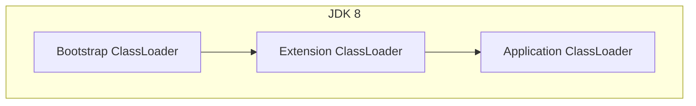
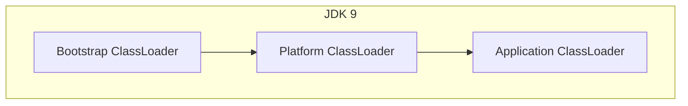
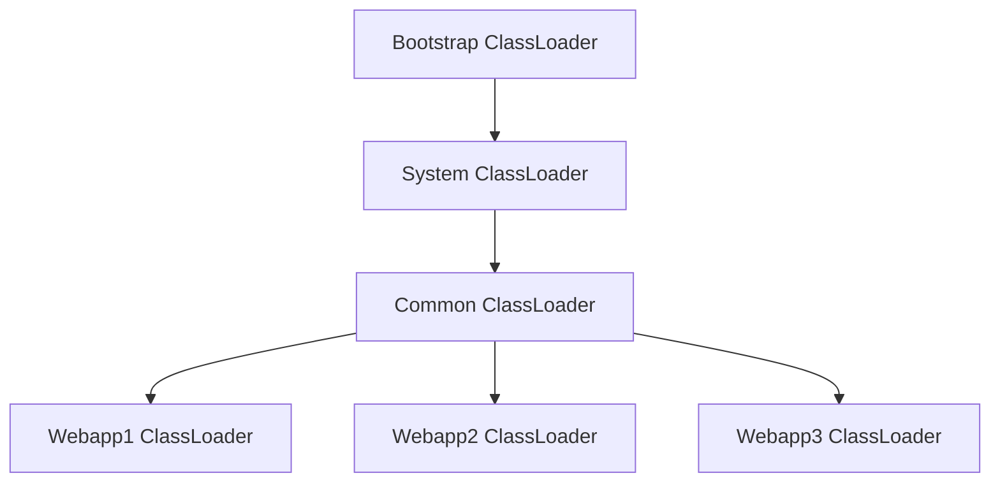
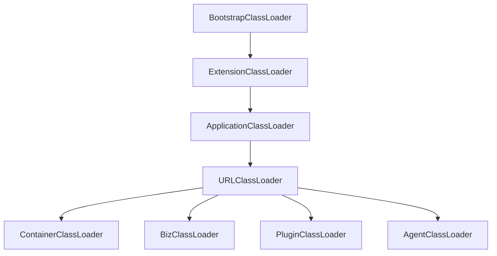

{
  "title": "ClassLoader类隔离",
  "date": "2024-11-13T21:56:49+08:00",
  "lastmod": "2024-11-13T21:56:49+08:00",
  "typecho_cid": 287,
  "url": "/archives/287/",
  "comments": false,
  "draft": false,
  "slug": "287",
  "categories": [
    "开发"
  ],
  "tags": [
    "Java"
  ],
  "math": true
}

# 基本概念

参考oracle jdk 21中对`ClassLoader`[定义](https://docs.oracle.com/en/java/javase/21/docs/api/java.base/java/lang/ClassLoader.html)

> A class loader is an object that is responsible for loading classes. The class `ClassLoader` is an abstract class. Given the [binary name](https://docs.oracle.com/en/java/javase/21/docs/api/java.base/java/lang/ClassLoader.html#binary-name) of a class, a class loader should attempt to locate or generate data that constitutes a definition for the class. A typical strategy is to transform the name into a file name and then read a "class file" of that name from a file system.
>

在Java中，`ClassLoader`负责加载类，当给定一个类的二进制名称，`ClassLoader`会尝试定位或生成构成该类定义的数据。

# 层次结构

`ClassLoader`遵循双亲委派模型，当请求查找类或资源时， `ClassLoader` 实例通常会将类或资源的搜索委托给其父类加载器，然后再尝试查找类或资源本身

由于JDK9中模块系统（Jigsaw）的引入，jdk8和jdk9类加载器层次结构有区别，`ExtClassLoader`变成`PlatformClassLoader`负责加载`--module-path`（或`MODPATH`环境变量）指定的模块





# 生命周期

类加载的过程可以分为几个阶段及常见异常

- 加载（Loading）

- ClassNotFoundException（找不到目标类）

- 验证（Verification）

- ClassFormatError（类文件格式不正确）
- NoClassDefFoundError（已加载的类无法初始化）

- 准备（Preparation）
- 解析（Resolution）

- LinkageError（类加载器无法找到或者无法链接到其他类或接口）

- IncompatibleClassChangeError
- AbstractMethodError
- NoSuchMethodError
- ...

- 初始化（Initialization）


# 核心方法

`ClassLoader`类提供了几个关键的方法来支持类的加载过程，其中`loadClass`和`findClass`最常使用

> ## loadClass
>
> ```java
> protected Class<?> loadClass(String name, boolean resolve) throws ClassNotFoundException
> ```
>
> Loads the class with the specified [binary name](https://docs.oracle.com/en/java/javase/21/docs/api/java.base/java/lang/ClassLoader.html#binary-name). The default implementation of this method searches for classes in the following order:
>
> 1. Invoke [findLoadedClass(String)](https://docs.oracle.com/en/java/javase/21/docs/api/java.base/java/lang/ClassLoader.html#findLoadedClass(java.lang.String)) to check if the class has already been loaded.
> 2. Invoke the [loadClass](https://docs.oracle.com/en/java/javase/21/docs/api/java.base/java/lang/ClassLoader.html#loadClass(java.lang.String)) method on the parent class loader. If the parent is `null` the class loader built into the virtual machine is used, instead.
> 3. Invoke the [findClass(String)](https://docs.oracle.com/en/java/javase/21/docs/api/java.base/java/lang/ClassLoader.html#findClass(java.lang.String)) method to find the class.
>
> If the class was found using the above steps, and the `resolve` flag is true, this method will then invoke the [resolveClass(Class)](https://docs.oracle.com/en/java/javase/21/docs/api/java.base/java/lang/ClassLoader.html#resolveClass(java.lang.Class)) method on the resulting `Class` object.
>
> Subclasses of `ClassLoader` are encouraged to override [findClass(String)](https://docs.oracle.com/en/java/javase/21/docs/api/java.base/java/lang/ClassLoader.html#findClass(java.lang.String)), rather than this method.
>
> Unless overridden, this method synchronizes on the result of [getClassLoadingLock](https://docs.oracle.com/en/java/javase/21/docs/api/java.base/java/lang/ClassLoader.html#getClassLoadingLock(java.lang.String)) method during the entire class loading process.
>
> **Parameters:**
>
> `name` - The [binary name](https://docs.oracle.com/en/java/javase/21/docs/api/java.base/java/lang/ClassLoader.html#binary-name) of the class
>
> `resolve` - If `true` then resolve the class
>
> **Returns:**
>
> The resulting `Class` object
>
> **Throws:**
>
> `ClassNotFoundException` - If the class could not be found

官方文档给出了方法设计介绍，loadClass用于实现双亲委派职责，当父类无法加载目标class时，调用子类的findClass加载。

当需要打破双亲委派模型时，则直接覆盖`loadClass`


> ## findClass
>
> ```java
> protected Class<?> findClass(String name) throws ClassNotFoundException
> ```
>
> Finds the class with the specified [binary name](https://docs.oracle.com/en/java/javase/21/docs/api/java.base/java/lang/ClassLoader.html#binary-name). This method should be overridden by class loader implementations that follow the delegation model for loading classes, and will be invoked by the [loadClass](https://docs.oracle.com/en/java/javase/21/docs/api/java.base/java/lang/ClassLoader.html#loadClass(java.lang.String)) method after checking the parent class loader for the requested class.
>
> **Implementation Requirements:**
>
> The default implementation throws `ClassNotFoundException`.
>
> **Parameters:**
>
> `name` - The [binary name](https://docs.oracle.com/en/java/javase/21/docs/api/java.base/java/lang/ClassLoader.html#binary-name) of the class
>
> **Returns:**
>
> The resulting `Class` object
>
> **Throws:**
>
> `ClassNotFoundException` - If the class could not be found
>
> **Since:**
>
> 1.2

在findClass用于实现自定义类加载逻辑


以常用的URLClassLoader为例，findClass将传入的类名转换成路径格式匹配在URLClassPath类路径下实际存在的文件结构，如果找到了对应的资源，则继续处理；否则返回null。

```java
public class URLClassLoader extends SecureClassLoader implements Closeable {
    protected Class<?> findClass(final String name)
    throws ClassNotFoundException
    {
        final Class<?> result;
        try {
            result = AccessController.doPrivileged(
                new PrivilegedExceptionAction<Class<?>>() {
                    public Class<?> run() throws ClassNotFoundException {
                        String path = name.replace('.', '/').concat(".class");
                        Resource res = ucp.getResource(path, false);
                        if (res != null) {
                            try {
                                return defineClass(name, res);
                            } catch (IOException e) {
                                throw new ClassNotFoundException(name, e);
                            }
                        } else {
                            return null;
                        }
                    }
                }, acc);
        } catch (java.security.PrivilegedActionException pae) {
            throw (ClassNotFoundException) pae.getException();
        }
        if (result == null) {
            throw new ClassNotFoundException(name);
        }
        return result;
    }
}
```


# 应用

## tomcat

为了支持应用隔离和模块化部署，tomcat扩展了已有的双亲委派模型

以tomcat9为例，其层次结构如下



- Bootstrap（所有应用可见，JVM核心依赖）

- $JAVA_HOME/jre/lib/ext

- System（所有应用可见，tomcat核心依赖）

- $CATALINA_HOME/bin

- Common（需要对所有应用可见的扩展类）
- Webapp（每个应用隔离，打破双亲委派，本地优先）


> As mentioned above, the web application class loader diverges from the default Java delegation model (in accordance with the recommendations in the Servlet Specification, version 2.4, section 9.7.2 Web Application Classloader). When a request to load a class from the web application's *WebappX* class loader is processed, this class loader will look in the local repositories **first**, instead of delegating before looking. 
>

重点在于webapp classloader，其打破双亲委派机制，当从 Web 应用程序的 WebappX 类加载器加载类的请求被处理时，这个类加载器会首先查看本地存储库，而不是先进行委托。

在应用程序视角，类查找顺序如下

1. Bootstrap ClassLoader
2. WebApp ClassLoader

1. /WEB-INF/classes
2. /WEB-INF/lib/*.jar 

1. System ClassLoader
2. Common ClassLoader

当应用配置`<Loader delegate="true"/>`时，可切换为标准双亲委派模型


## OSGi

OSGi是一个 Java 模块化系统和服务平台，它提供了一种动态管理模块（Bundle）的方法，支持不停止应用程序的情况下动态更新、添加或删除模块。


以Apache Felix实现的OSGi为例，其查找逻辑如下

1. **循环检测**：防止在查找过程中出现无限递归。
2. **委托给父类加载器**：如果目标类或资源属于需要委托给父类加载器处理的包，则先尝试使用父类加载器进行查找。
3. **从导入列表中查找**：在当前修订版本的导入列表中搜索类或资源。
4. **从本地类路径查找**：如果前面步骤未能找到，则尝试从当前修订版本自己的类路径中查找。
5. **从动态导入中查找**：最后，如果还没有找到，则会尝试从动态导入中查找。

```java
private Object findClassOrResourceByDelegation(String name, boolean isClass)
        throws ClassNotFoundException, ResourceNotFoundException
    {
        // 初始化结果为null，表示尚未找到类或资源
        Object result = null;

        // 用于循环检测的集合，避免在查找过程中出现无限递归的情况
        Set requestSet = (Set) m_cycleCheck.get();
        if (requestSet == null)
        {
            // 如果当前线程中没有设置循环检测集合，则创建一个新的并设置到当前线程
            requestSet = new HashSet();
            m_cycleCheck.set(requestSet);
        }
        // 将要查找的名字添加到循环检测集合中，如果已经存在说明出现了循环依赖
        if (requestSet.add(name))
        {
            try
            {
                // 根据是查找类还是资源来获取目标的包名
                String pkgName = (isClass)
                    ? Util.getClassPackage(name)
                    : Util.getResourcePackage(name);

                // 检查是否应该将该包委托给父类加载器
                if (shouldBootDelegate(pkgName))
                {
                    try
                    {
                        // 获取适当的类加载器进行委托
                        ClassLoader bdcl = getBootDelegationClassLoader();
                        // 根据是要查找类还是资源，调用相应的方法
                        result = (isClass)
                            ? (Object) bdcl.loadClass(name)
                            : (Object) bdcl.getResource(name);
                        // 如果是java.*包下的内容或者已经找到了结果，则直接返回
                        if (pkgName.startsWith("java.") || (result != null))
                        {
                            return result;
                        }
                    }
                    catch (ClassNotFoundException ex)
                    {
                        // 如果是java.*包下的类且未找到，则抛出异常
                        if (pkgName.startsWith("java."))
                        {
                            throw ex;
                        }
                    }
                }

                // 在导入列表中查找
                result = searchImports(pkgName, name, isClass);

                // 如果在导入列表中未找到，则尝试从修订版本自己的类路径中查找
                if (result == null)
                {
                    if (isClass)
                    {
                        // 获取内部类加载器，并尝试加载类
                        ClassLoader cl = getClassLoaderInternal();
                        if (cl == null)
                        {
                            // 如果类加载器无效，则抛出异常
                            throw new ClassNotFoundException(
                                "Unable to load class '"
                                + name
                                + "' because the bundle wiring for "
                                + m_revision.getSymbolicName()
                                + " is no longer valid.");
                        }
                        result = ((BundleClassLoader) cl).findClass(name);
                    }
                    else
                    {
                        // 如果不是查找类而是资源，则使用修订版本的方法来查找资源
                        result = m_revision.getResourceLocal(name);
                    }

                    // 如果还是没找到，则尝试从动态导入中查找
                    if (result == null)
                    {
                        result = searchDynamicImports(pkgName, name, isClass);
                    }
                }
            }
            finally
            {
                // 清理：从循环检测集合中移除当前查找的名字
                requestSet.remove(name);
            }
        }
        else
        {
            // 如果检测到循环依赖，则返回null以打破循环
            return null;
        }

        // 如果最终结果仍为null，根据查找类型抛出相应的异常
        if (result == null)
        {
            if (isClass)
            {
                throw new ClassNotFoundException(
                    name + " not found by " + this.getBundle());
            }
            else
            {
                throw new ResourceNotFoundException(
                    name + " not found by " + this.getBundle());
            }
        }

        // 返回最终找到的结果
        return result;
    }
```

## SofaArk

SofaArk是蚂蚁集团开源轻量类隔离框架

其定义3个概念：Ark Container，Ark Plugin，Ark Biz。


- sofaark通过maven插件在打包时将插件启动器、导出类、导入类、导出资源、导入资源、优先级等元信息保存在 Ark Plugin 中的 META-INF/MANIFEST.MF 中，每个ark plugin都有独立的类加载器读取插件元信息和类资源导入导出关系。插件之间可以互相委托加载类。
- ark biz只能加载自己模块的类信息，也可以委托plugin加载所需的类。




### 源码

AbstractClasspathClassLoader提供了类加载查找模式的抽象实现，loadClass会从以下顺序查找

1. 本地类加载缓存
2. 子类实现的loadClassInternal方法

BizClassLoader实现如下

```java
package com.alipay.sofa.ark.container.service.classloader;

public class BizClassLoader extends AbstractClasspathClassLoader {

    
    @Override
    protected Class<?> loadClassInternal(String name, boolean resolve) throws ArkLoaderException {
        Class<?> clazz = null;

        // 0. sun reflect related class throw exception directly
        if (classloaderService.isSunReflectClass(name)) {
            throw new ArkLoaderException(
                String
                    .format(
                        "[ArkBiz Loader] %s : can not load class: %s, this class can only be loaded by sun.reflect.DelegatingClassLoader",
                        bizIdentity, name));
        }

        // 1. findLoadedClass
        if (clazz == null) {
            clazz = findLoadedClass(name);
        }

        // 2. JDK related class
        if (clazz == null) {
            clazz = resolveJDKClass(name);
        }

        // 3. Ark Spi class
        if (clazz == null) {
            clazz = resolveArkClass(name);
        }

        // 4. pre find class
        if (clazz == null) {
            clazz = preLoadClass(name);
        }

        // 5. Plugin Export class
        if (clazz == null) {
            clazz = resolveExportClass(name);
        }

        // 6. Biz classpath class
        if (clazz == null) {
            clazz = resolveLocalClass(name);
        }

        // 7. Java Agent ClassLoader for agent problem
        if (clazz == null) {
            clazz = resolveJavaAgentClass(name);
        }

        // 8. post find class
        if (clazz == null) {
            clazz = postLoadClass(name);
        }

        if (clazz != null) {
            if (resolve) {
                super.resolveClass(clazz);
            }
            return clazz;
        }

        throw new ArkLoaderException(String.format("[ArkBiz Loader] %s : can not load class: %s",
            bizIdentity, name));
    }
}
```

PluginClassLoader实现如下

```java
package com.alipay.sofa.ark.container.service.classloader;

public class PluginClassLoader extends AbstractClasspathClassLoader {

	@Override
    protected Class<?> loadClassInternal(String name, boolean resolve) throws ArkLoaderException {
        Class<?> clazz = null;

        // 0. sun reflect related class throw exception directly
        if (classloaderService.isSunReflectClass(name)) {
            throw new ArkLoaderException(
                String
                    .format(
                        "[ArkPlugin Loader] %s : can not load class: %s, this class can only be loaded by sun.reflect.DelegatingClassLoader",
                        pluginName, name));
        }

        // 1. findLoadedClass
        if (clazz == null) {
            clazz = findLoadedClass(name);
        }

        // 2. JDK related class
        if (clazz == null) {
            clazz = resolveJDKClass(name);
        }

        // 3. Ark Spi class
        if (clazz == null) {
            clazz = resolveArkClass(name);
        }

        // 4. pre find class
        if (clazz == null) {
            clazz = preLoadClass(name);
        }

        // 5. Import class export by other plugins
        if (clazz == null) {
            clazz = resolveExportClass(name);
        }

        // 6. Plugin classpath class
        if (clazz == null) {
            clazz = resolveLocalClass(name);
        }

        // 7. Java Agent ClassLoader for agent problem
        if (clazz == null) {
            clazz = resolveJavaAgentClass(name);
        }

        // 8. Post find class
        if (clazz == null) {
            clazz = postLoadClass(name);
        }

        if (clazz != null) {
            if (resolve) {
                super.resolveClass(clazz);
            }
            return clazz;
        }

        throw new ArkLoaderException(String.format(
            "[ArkPlugin Loader] %s : can not load class: %s", pluginName, name));
    }
}
```

- 流程基本一致，主要在于plugin和biz读取到的import类元信息不同


# 参考资料

- [ClassLoader (Java SE 21 & JDK 21) (oracle.com)](https://docs.oracle.com/en/java/javase/21/docs/api/java.base/java/lang/ClassLoader.html)
- [Apache Tomcat 9 (9.0.94) - Class Loader How-To](https://tomcat.apache.org/tomcat-9.0-doc/class-loader-howto.html)
- [apache/felix-atomos: Apache Felix Atomos (github.com)](https://github.com/apache/felix-atomos)
- [org.apache.felix.framework/src/main/java/org/apache/felix/framework/BundleWiringImpl.java at master · snefru/org.apache.felix.framework (github.com)](https://github.com/snefru/org.apache.felix.framework/blob/master/src/main/java/org/apache/felix/framework/BundleWiringImpl.java)
- https://www.sofastack.tech/projects/sofa-boot/sofa-ark-readme/
